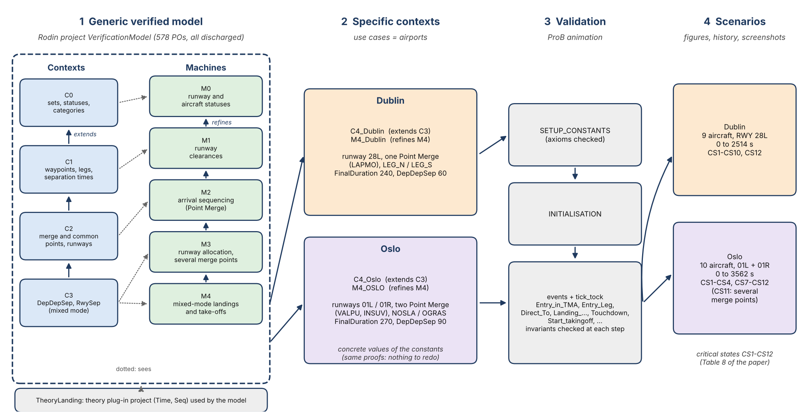

# Verified Modelling of Landing and Take-off Operations in Air Traffic Control

Event-B model of arrival sequencing with **Point Merge** and of mixed-mode runway operations (landings and take-offs), proved with **Rodin** and validated by animation with **ProB** on two airports: **Dublin** and **Oslo**.

This repository accompanies the paper *Verified Modelling of Landing and Take-off Operations in Air Traffic Control*.

(source: [`docs/schema_projet.svg`](docs/schema_projet.svg))

## 1. The generic verified model

Rodin project [`rodin/VerificationModel`](rodin/VerificationModel).

| Level | Content |
|---|---|
| C0 → C1 → C2 → C3 | contexts (each one extends the previous one): sets, constants and axioms of the airspace, the separations and the airport |
| M0 | runway and aircraft statuses |
| M1 | runway clearances (landing and take-off verification) |
| M2 | arrival sequencing with Point Merge (time, legs, direct-to, separations) |
| M3 | runway allocation, several merge points and common points |
| M4 | mixed-mode operations: landings and take-offs on the same runways |

Each machine refines the previous one and sees the corresponding context. **578 proof obligations, all discharged** (551 automatically, 27 with the interactive prover).

| Element | Total | Automatic | Interactive |
|---|---:|---:|---:|
| C0 | 6 | 6 | 0 |
| C1 | 13 | 11 | 2 |
| C2 | 0 | 0 | 0 |
| C3 | 1 | 1 | 0 |
| M0 | 48 | 48 | 0 |
| M1 | 40 | 40 | 0 |
| M2 | 274 | 257 | 17 |
| M3 | 90 | 83 | 7 |
| M4 | 106 | 105 | 1 |
| **Total** | **578** | **551** | **27** |

The model uses the theories of the project [`rodin/TheoryLanding`](rodin/TheoryLanding) (`Time`, `Seq`).

## 2. Specific contexts (use cases)

The contexts and machines of each airport are in the same Rodin project, because the instance must see the generic model. They only give values to the constants, so the proofs of the generic model are not redone.

| Airport | Context | Machine | Configuration |
|---|---|---|---|
| Dublin | `C4_Dublin.buc` (extends C3) | `M4_Dublin.bum` (refines M4) | runway 28L, one Point Merge system (merge point LAPMO), legs LEG_N and LEG_S |
| Oslo | `C4_Oslo.buc` (extends C3) | `M4_OSLO.bum` (refines M4) | runways 01L and 01R, two Point Merge systems (VALPU, INSUV), common points NOSLA and OGRAS |

## 3. Validation by animation (ProB)

The scenarios are in [`animation/`](animation).

| Scenario | Aircraft | Runways | Duration | Critical states |
|---|---|---|---|---|
| [Dublin](animation/dublin) | 9 | 28L | 0 – 2514 s | CS1 – CS10, CS12 |
| [Oslo](animation/oslo) | 10 | 01L, 01R | 0 – 3562 s | CS1 – CS4, CS7 – CS12 |

Each scenario folder contains:

- `README.md`: aircraft, instants and critical states (with the values computed by ProB);
- `fig_scenario_*.png`: timeline of the scenario;
- `steps/`: screenshots of the animation;
- `history/`: the exact trace (ProB *History* view);
- `critical_states/`: screenshots of the critical states.

The critical states CS1 – CS12 are defined in Table 8 of the paper. CS11 (a direct-to refused at a common point shared by two merge points) only appears at Oslo.

### Reproducing an animation

1. Import `rodin/TheoryLanding` and `rodin/VerificationModel` in Rodin (*File → Import → General → Existing Projects into Workspace*), then let Rodin rebuild the projects.
2. Open `M4_Dublin` or `M4_OSLO` and start ProB (*Animate / Model Check*).
3. Run `SETUP_CONSTANTS` and `INITIALISATION`, then play the events of `history/` (read each image from the bottom to the top).

## Requirements

- Rodin with the Theory plug-in and ProB.
- Both Rodin projects are needed (`VerificationModel` uses `TheoryLanding`).

## Notes

- The files `*.bcc` and `*.bcm` (output of the static checker) are not versioned: Rodin regenerates them.
- The proof files `*.bpr` are versioned, since they contain the proofs; `M2.bpr` is large (about 90 MB).

## Citation and licence

To be completed (DOI of the archive, licence).
